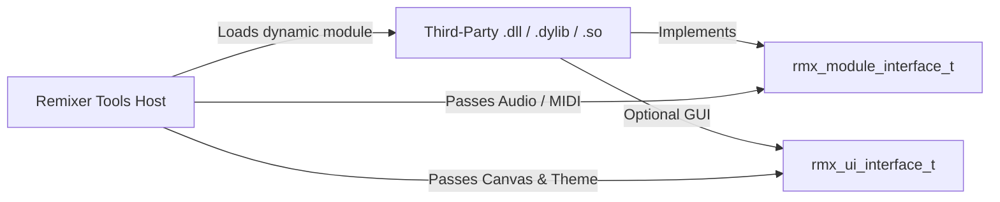

# Getting Started with Remixer Tools SDK

Welcome to the **Remixer Tools SDK (`remixer-sdk`)**. This guide walks third-party developers through creating, building, and deploying dynamic modules and plugins for the Remixer Tools audio ecosystem.

---

## 📖 Table of Contents
1. [SDK Architecture Overview](#sdk-architecture-overview)
2. [Prerequisites](#prerequisites)
3. [Creating Your First Module](#creating-your-first-module)
4. [Project CMake Configuration](#project-cmake-configuration)
5. [Exporting Required Symbols](#exporting-required-symbols)
6. [Testing & Verification](#testing--verification)

---

## 1. SDK Architecture Overview

Remixer Tools uses a **Pure C-ABI (C11 Linkage)** plugin architecture. This ensures:
- **No Compiler Lock-in**: Build with MSVC, Clang, or GCC without C++ Name Mangling conflicts.
- **Strict Data Alignment**: All critical structures use `#pragma pack(push, 8)` or `#pragma pack(push, 4)` to guarantee exact memory layouts across all platforms.
- **Real-Time Safety**: Audio processing callbacks are strictly lock-free and zero-allocation.
- **Universal Packaging**: Shipped as encrypted, digitally signed `.rmxpkg` containers running on Windows, macOS, and Linux.



---

## 2. Prerequisites

- **C/C++ Compiler**:
  - Windows: MSVC 2022 (x64) or Clang-CL
  - macOS: Xcode Clang 14+ (ARM64 / x86_64)
  - Linux: GCC 11+ or Clang 13+
- **Build System**: CMake 3.20 or newer
- **Remixer Tools Packaging Tool**: `rmxpkg` CLI

---

## 3. Creating Your First Module

Create a single C file (`my_module.c`):

```c
#include <remixer/remixer.h>
#include <stdlib.h>
#include <string.h>

typedef struct {
    float gain; // 0.0 to 2.0 (default 1.0)
} MyModuleContext;

static rmx_status_t RMX_CALL my_init(rmx_handle_t* instance, const char* config_json) {
    (void)config_json;
    if (!instance) return RMX_ERR_NULL_POINTER;
    MyModuleContext* ctx = (MyModuleContext*)calloc(1, sizeof(MyModuleContext));
    if (!ctx) return RMX_ERR_OUT_OF_MEMORY;
    ctx->gain = 1.0f;
    *instance = (rmx_handle_t)ctx;
    return RMX_OK;
}

static rmx_status_t RMX_CALL my_prepare_to_play(rmx_handle_t instance, uint32_t sample_rate, uint32_t max_block_size) {
    (void)instance; (void)sample_rate; (void)max_block_size;
    return RMX_OK;
}

static rmx_status_t RMX_CALL my_process_audio(rmx_handle_t instance, const rmx_audio_buffer_t* in_buf, rmx_audio_buffer_t* out_buf) {
    if (!instance || !in_buf || !out_buf) return RMX_ERR_NULL_POINTER;
    MyModuleContext* ctx = (MyModuleContext*)instance;

    uint32_t channels = in_buf->num_channels < out_buf->num_channels ? in_buf->num_channels : out_buf->num_channels;
    for (uint32_t c = 0; c < channels; ++c) {
        for (uint32_t i = 0; i < in_buf->num_frames; ++i) {
            out_buf->channels[c][i] = in_buf->channels[c][i] * ctx->gain;
        }
    }
    return RMX_OK;
}

static rmx_status_t RMX_CALL my_set_parameter(rmx_handle_t instance, uint32_t param_id, float value) {
    if (!instance) return RMX_ERR_NOT_INITIALIZED;
    MyModuleContext* ctx = (MyModuleContext*)instance;
    if (param_id == 0) {
        ctx->gain = value;
        return RMX_OK;
    }
    return RMX_ERR_INVALID_ARGUMENT;
}

static rmx_status_t RMX_CALL my_get_parameter(rmx_handle_t instance, uint32_t param_id, float* out_value) {
    if (!instance || !out_value) return RMX_ERR_NULL_POINTER;
    MyModuleContext* ctx = (MyModuleContext*)instance;
    if (param_id == 0) {
        *out_value = ctx->gain;
        return RMX_OK;
    }
    return RMX_ERR_INVALID_ARGUMENT;
}

static rmx_status_t RMX_CALL my_destroy(rmx_handle_t instance) {
    if (!instance) return RMX_ERR_NULL_POINTER;
    free(instance);
    return RMX_OK;
}

// Module vtable
static const rmx_module_interface_t g_interface = {
    my_init,
    my_prepare_to_play,
    my_process_audio,
    NULL, // process_midi
    my_set_parameter,
    my_get_parameter,
    NULL, // get_ui_interface (NULL if no custom UI)
    NULL, // reset
    my_destroy
};

// Exported Symbols
RMX_API rmx_status_t RMX_CALL rmx_get_module_desc(rmx_module_desc_t* out_desc) {
    if (!out_desc) return RMX_ERR_NULL_POINTER;
    memset(out_desc, 0, sizeof(rmx_module_desc_t));
    out_desc->api_version = RMX_CURRENT_VERSION;
    strncpy(out_desc->module_id, "com.example.gain_module", sizeof(out_desc->module_id) - 1);
    strncpy(out_desc->name, "Example Gain Module", sizeof(out_desc->name) - 1);
    strncpy(out_desc->vendor, "My Company", sizeof(out_desc->vendor) - 1);
    strncpy(out_desc->version_str, "1.0.0", sizeof(out_desc->version_str) - 1);
    out_desc->category = RMX_CAT_CORE_DSP;
    out_desc->flags = RMX_MOD_FLAG_REALTIME_SAFE;
    return RMX_OK;
}

RMX_API rmx_status_t RMX_CALL rmx_create_module(const rmx_module_interface_t** out_interface, rmx_handle_t* out_instance) {
    if (!out_interface || !out_instance) return RMX_ERR_NULL_POINTER;
    *out_interface = &g_interface;
    return my_init(out_instance, NULL);
}
```

---

## 4. Project CMake Configuration

In your `CMakeLists.txt`:

```cmake
cmake_minimum_required(VERSION 3.20)
project(MyModule LANGUAGES C CXX)

# Add SDK dependency
add_subdirectory(path/to/remixer-tools-sdk remixer_sdk_build EXCLUDE_FROM_ALL)

# Create shared module library
add_library(my_module SHARED
    src/my_module.c
)

target_compile_definitions(my_module PRIVATE RMX_BUILDING_DLL)
target_link_libraries(my_module PRIVATE remixer::sdk)

# Output naming
set_target_properties(my_module PROPERTIES
    PREFIX ""
    OUTPUT_NAME "my_module"
)
```

---

## 5. Exporting Required Symbols

Every dynamic library (.dll, .dylib, .so) must export:
- `rmx_get_module_desc` (`RMX_ENTRY_GET_DESC`)
- `rmx_create_module` (`RMX_ENTRY_CREATE_MOD`)

These entry points allow the host to discover module identity, capabilities, and lifecycle handlers.

---

## 6. Testing & Packaging

After compilation:
1. Create a `manifest.json`:
   ```json
   {
       "id": "com.example.gain_module",
       "name": "Example Gain Module",
       "version": "1.0.0",
       "category": "CORE_DSP",
       "vendor": "My Company",
       "package_type": "universal",
       "supported_platforms": ["windows_x64", "macos_arm64", "linux_x64"],
       "api_version": "1.0.0"
   }
   ```
2. Package into Universal `.rmxpkg`:
   ```bash
   rmxpkg pack --manifest manifest.json --target windows_x64=build/my_module.dll --out my_module.rmxpkg
   ```
3. Copy `my_module.rmxpkg` to the host application's `modules/` directory.
