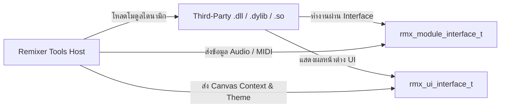

# คู่มือเริ่มต้นพัฒนาโมดูลด้วย Remixer Tools SDK

ยินดีต้อนรับสู่ **Remixer Tools SDK (`remixer-sdk`)** คู่มือนี้ออกแบบมาเพื่อแนะนำนักพัฒนาภายนอก (Third-Party Developers) ในการสร้าง, คอมไพล์, และแพ็กเกจโมดูลหรือปลั๊กอินสำหรับระบบเสียง Remixer Tools

---

## 📖 สารบัญ
1. [ภาพรวมสถาปัตยกรรม SDK](#1-ภาพรวมสถาปัตยกรรม-sdk)
2. [เครื่องมือและสิ่งที่จำเป็น](#2-เครื่องมือและสิ่งที่จำเป็น)
3. [การเขียนโค้ดโมดูลตัวแรก](#3-การเขียนโค้ดโมดูลตัวแรก)
4. [การตั้งค่า CMake ของโปรเจกต์](#4-การตั้งค่า-cmake-ของโปรเจกต์)
5. [ฟังก์ชัน Entry Points ที่ต้อง Export](#5-ฟังก์ชัน-entry-points-ที่ต้อง-export)
6. [การทดสอบและแพ็กเกจเป็นไฟล์ .rmxpkg](#6-การทดสอบและแพ็กเกจเป็นไฟล์-rmxpkg)

---

## 1. ภาพรวมสถาปัตยกรรม SDK

Remixer Tools ใช้การเชื่อมต่อแบบ **Pure C-ABI (C11 Linkage)** โดยมีจุดเด่นดังนี้:
- **ไร้ปัญหาคอมไพเลอร์ขัดแย้ง (No Compiler Lock-in):** สามารถเขียนด้วย MSVC, Clang หรือ GCC ได้โดยไม่มีปัญหาเรื่อง C++ Name Mangling
- **การจัดเรียง Memory ที่แน่นอน (Strict Data Alignment):** โครงสร้างข้อมูลทั้งหมดควบคุมด้วย `#pragma pack(push, 8)` หรือ `#pragma pack(push, 4)` เพื่อรับประกันว่าทุก OS จะเห็นข้อมูลตรงกัน
- **ความปลอดภัยระดับ Real-Time:** Callback ประมวลผลเสียง (`process_audio`) ปราศจากการจอง Memory และไม่มีการใช้ Lock (Zero-Allocation & Lock-Free)
- **แพ็กเกจแบบ Universal:** บรรจุไฟล์ไบนารีข้ามระบบปฏิบัติการไว้ในไฟล์ `.rmxpkg` เพียงไฟล์เดียว



---

## 2. เครื่องมือและสิ่งที่จำเป็น

- **คอมไพเลอร์ C/C++:**
  - Windows: MSVC 2022 (x64) หรือ Clang-CL
  - macOS: Xcode Clang 14+ (ARM64 / x86_64)
  - Linux: GCC 11+ หรือ Clang 13+
- **Build System:** CMake เวอร์ชัน 3.20 ขึ้นไป
- **เครื่องมือแพ็กเกจ:** CLI `rmxpkg`

---

## 3. การเขียนโค้ดโมดูลตัวแรก

สร้างไฟล์ C ขึ้นมา 1 ไฟล์ (`my_module.c`):

```c
#include <remixer/remixer.h>
#include <stdlib.h>
#include <string.h>

// โครงสร้างเก็บข้อมูลภายในโมดูล (Opaque State)
typedef struct {
    float gain; // ค่าความดัง 0.0 ถึง 2.0 (ค่าเริ่มต้น 1.0)
} MyModuleContext;

// 1. กำหนดค่าเริ่มต้นให้กับโมดูล
static rmx_status_t RMX_CALL my_init(rmx_handle_t* instance, const char* config_json) {
    (void)config_json;
    if (!instance) return RMX_ERR_NULL_POINTER;
    MyModuleContext* ctx = (MyModuleContext*)calloc(1, sizeof(MyModuleContext));
    if (!ctx) return RMX_ERR_OUT_OF_MEMORY;
    ctx->gain = 1.0f;
    *instance = (rmx_handle_t)ctx;
    return RMX_OK;
}

// 2. เตรียมหน่วยความจำก่อนเล่นเสียง
static rmx_status_t RMX_CALL my_prepare_to_play(rmx_handle_t instance, uint32_t sample_rate, uint32_t max_block_size) {
    (void)instance; (void)sample_rate; (void)max_block_size;
    return RMX_OK;
}

// 3. ฟังก์ชันประมวลผลสัญญาณเสียงแบบ Real-time (ห้าม malloc / ห้าม lock)
static rmx_status_t RMX_CALL my_process_audio(rmx_handle_t instance, const rmx_audio_buffer_t* in_buf, rmx_audio_buffer_t* out_buf) {
    if (!instance || !in_buf || !out_buf) return RMX_ERR_NULL_POINTER;
    MyModuleContext* ctx = (MyModuleContext*)instance;

    uint32_t channels = in_buf->num_channels < out_buf->num_channels ? in_buf->num_channels : out_buf->num_channels;
    for (uint32_t c = 0; c < channels; ++c) {
        for (uint32_t i = 0; i < in_buf->num_frames; ++i) {
            out_buf->channels[c][i] = in_buf->channels[c][i] * ctx->gain;
        }
    }
    return RMX_OK;
}

// 4. การจัดการพารามิเตอร์
static rmx_status_t RMX_CALL my_set_parameter(rmx_handle_t instance, uint32_t param_id, float value) {
    if (!instance) return RMX_ERR_NOT_INITIALIZED;
    MyModuleContext* ctx = (MyModuleContext*)instance;
    if (param_id == 0) {
        ctx->gain = value;
        return RMX_OK;
    }
    return RMX_ERR_INVALID_ARGUMENT;
}

static rmx_status_t RMX_CALL my_get_parameter(rmx_handle_t instance, uint32_t param_id, float* out_value) {
    if (!instance || !out_value) return RMX_ERR_NULL_POINTER;
    MyModuleContext* ctx = (MyModuleContext*)instance;
    if (param_id == 0) {
        *out_value = ctx->gain;
        return RMX_OK;
    }
    return RMX_ERR_INVALID_ARGUMENT;
}

// 5. คืนหน่วยความจำเมื่อปิดโมดูล
static rmx_status_t RMX_CALL my_destroy(rmx_handle_t instance) {
    if (!instance) return RMX_ERR_NULL_POINTER;
    free(instance);
    return RMX_OK;
}

// ตารางฟังก์ชันของโมดูล (Module vtable)
static const rmx_module_interface_t g_interface = {
    my_init,
    my_prepare_to_play,
    my_process_audio,
    NULL, // process_midi
    my_set_parameter,
    my_get_parameter,
    NULL, // get_ui_interface (ใส่ NULL ถ้าไม่มี Custom UI)
    NULL, // reset
    my_destroy
};

// ---------------------------------------------------------------------------
// Exported Symbols สำหรับให้ Host โหลด
// ---------------------------------------------------------------------------
RMX_API rmx_status_t RMX_CALL rmx_get_module_desc(rmx_module_desc_t* out_desc) {
    if (!out_desc) return RMX_ERR_NULL_POINTER;
    memset(out_desc, 0, sizeof(rmx_module_desc_t));
    out_desc->api_version = RMX_CURRENT_VERSION;
    strncpy(out_desc->module_id, "com.example.gain_module", sizeof(out_desc->module_id) - 1);
    strncpy(out_desc->name, "Example Gain Module", sizeof(out_desc->name) - 1);
    strncpy(out_desc->vendor, "My Company", sizeof(out_desc->vendor) - 1);
    strncpy(out_desc->version_str, "1.0.0", sizeof(out_desc->version_str) - 1);
    out_desc->category = RMX_CAT_CORE_DSP;
    out_desc->flags = RMX_MOD_FLAG_REALTIME_SAFE;
    return RMX_OK;
}

RMX_API rmx_status_t RMX_CALL rmx_create_module(const rmx_module_interface_t** out_interface, rmx_handle_t* out_instance) {
    if (!out_interface || !out_instance) return RMX_ERR_NULL_POINTER;
    *out_interface = &g_interface;
    return my_init(out_instance, NULL);
}
```

---

## 4. การตั้งค่า CMake ของโปรเจกต์

เขียนไฟล์ `CMakeLists.txt`:

```cmake
cmake_minimum_required(VERSION 3.20)
project(MyModule LANGUAGES C CXX)

# นำเข้า SDK
add_subdirectory(path/to/remixer-tools-sdk remixer_sdk_build EXCLUDE_FROM_ALL)

# สร้างเป็น Dynamic Library (.dll / .dylib / .so)
add_library(my_module SHARED
    src/my_module.c
)

target_compile_definitions(my_module PRIVATE RMX_BUILDING_DLL)
target_link_libraries(my_module PRIVATE remixer::sdk)

set_target_properties(my_module PROPERTIES
    PREFIX ""
    OUTPUT_NAME "my_module"
)
```

---

## 5. ฟังก์ชัน Entry Points ที่ต้อง Export

ทุก Dynamic Library ของโมดูล ต้องทำการ Export ฟังก์ชัน C ต่อไปนี้:
- `rmx_get_module_desc` (`RMX_ENTRY_GET_DESC`)
- `rmx_create_module` (`RMX_ENTRY_CREATE_MOD`)

โปรแกรมหลักของ Remixer จะเรียก 2 ฟังก์ชันนี้ผ่าน `GetProcAddress` หรือ `dlsym` เพื่อเริ่มการทำงาน

---

## 6. การทดสอบและแพ็กเกจเป็นไฟล์ .rmxpkg

1. สร้างไฟล์ `manifest.json`:
   ```json
   {
       "id": "com.example.gain_module",
       "name": "Example Gain Module",
       "version": "1.0.0",
       "category": "CORE_DSP",
       "vendor": "My Company",
       "package_type": "universal",
       "supported_platforms": ["windows_x64", "macos_arm64", "linux_x64"],
       "api_version": "1.0.0"
   }
   ```
2. สั่งแพ็กเป็นไฟล์ Universal Package ด้วยคำสั่ง:
   ```bash
   rmxpkg pack --manifest manifest.json --target windows_x64=build/my_module.dll --out my_module.rmxpkg
   ```
3. นำไฟล์ `my_module.rmxpkg` ไปวางในโฟลเดอร์ `modules/` ของโปรแกรม Remixer Tools พร้อมเปิดใช้งานได้ทันทีครับ
